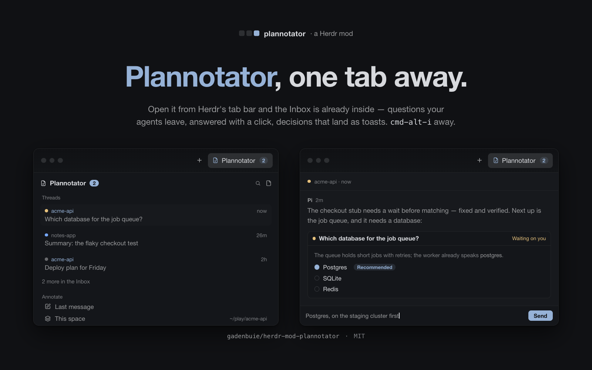

# Plannotator

Your agents' questions, summaries and reviews, beside Files and Changes:
a [Plannotator](https://plannotator.ai) panel in the tab bar of the
[Herdr](https://herdr.dev) desktop app (`herdr-app`; written against
0.1.12).

A **Plannotator** button shows how many threads are waiting on you while
the panel is closed; clicking it opens the Inbox's threads in the side
panel, each with a dot for what it needs — yellow asks something, blue is
new since you looked, grey is read. Read any thread as markdown right
there, answer its questions by clicking their choices, reply in words
without leaving the terminal. When a decision is made in a Plannotator
session, it arrives as a Herdr toast the second it happens — panel open or
not.



The panel also carries the annotate list: the last message, your changes,
this space's whole folder, one file or folder out of a tree, another
folder from a picker — each started as a background `plannotator` session
in the folder you're working in. And the panel's view sticks to its space:
the thread you had open and the folders you had expanded come back when
you do.

- `mods/plannotator/` — the panel, its palette, and a row's menu: one mod.
- `install.sh` — installs it: copy the mod, merge the keys, `herdr-app check`.
- `RECIPE.md` — the recipe in Herdr's six parts: what you see, how it
  behaves, what it is built from, and the traps that cost the build.

## Install

```sh
git clone https://github.com/gadenbuie/herdr-mod-plannotator.git
cd herdr-mod-plannotator
make install   # runs ./install.sh
```

`install.sh` copies the mod into `~/.config/herdr-app/mods/`, adds the key
bindings you don't already have (replacing nothing, with a backup beside
your `keys.json`), and runs `herdr-app check`. Without tab-host it also
docks the panel on the right — Herdr's one-time first dock; after that
it is a normal block in your layout, to move, resize or remove like any
panel. With tab-host the manifest ships as-is
(`place: "none"`) and the panel lives on the tab bar's tab. Or skip the
script entirely: your agent can copy `mods/plannotator/` into
`~/.config/herdr-app/mods/`, add its block
(`{"type": "block", "content": {"mod": "plannotator"}}`) to a layout you
own, and merge the keys — the same panel either way.

The button needs [herdr-mod-tab-host](https://github.com/gadenbuie/herdr-mod-tab-host)
installed — it draws one button per mod that declares a tab, and the
panel's tab in the side panel is its block: the button in the tab bar,
the badge while the panel is closed, and the view that follows you from
space to space are all its. tab-host is optional, though: without it
`install.sh` installs the same panel as a normal Herdr side panel
(`place: "right"`) — no button, no badge, no per-space carry — and
binds `cmd-alt-i` to the plain `layout.toggle:panel` instead of the
button's own toggle. Rerun `./install.sh` after installing or removing
tab-host and the two modes swap.

The panel talks to Plannotator's own Inbox server on `127.0.0.1` — the
same requests its page opens with — and needs the `plannotator` CLI on
`PATH` (written against 0.28). The button appears only where
`command -v plannotator` answers.

## The tab, declared

The button is `tab-host`'s; this mod joins by declaring a tab in its own
`mod.json` — no code, no registration, no layout edit:

```json
{
  "place": "none",
  "focusable": true,
  "tab": {
    "title": "Plannotator",
    "icon": "mods/plannotator/icon.svg",
    "badge": "plannotator.waiting",
    "state": "plannotator.state",
    "show": "command -v plannotator >/dev/null 2>&1",
    "order": 200
  }
}
```

| Field | What it does here |
| ----- | ----------------- |
| `tab.title` | The button's label. |
| `tab.icon` | A 16 px page-with-a-check glyph, tinted with the text color. |
| `tab.badge` | The count of threads waiting on you, published on `plannotator.waiting`; drawn as a chip after the label, visible while the panel is closed. |
| `tab.state` | The panel's view — the thread on screen, the folders open in the tree — kept one value per space, so it comes back when you do. |
| `tab.show` | A shell string; the button appears only in spaces whose machine has `plannotator` on `PATH`. |
| `tab.order` | Puts the button at the right end of the tab bar's contributors. |

`place: "none"` keeps Herdr from docking a copy of the mod on its own;
`focusable` is what lets the panel take the keyboard when it is clicked
into, so it never steals the keys from the terminal that opened it.

## Keys

| Key (macOS) | Does |
| ----------- | ---- |
| `cmd-alt-i` | Show the panel on its tab, or hide it — the button's own behaviour (`tab-host.toggle:plannotator`). Without tab-host: `layout.toggle:panel`, the plain panel toggle. |
| `cmd-alt-shift-p` | The mod's own palette: annotate, review, open the Inbox. |
| `cmd-alt-l` | Annotate the last message. |
| `cmd-alt-r` | Review my changes. |
| `cmd-alt-a` | Annotate this space's folder. |
| `cmd-alt-shift-i` | Open the Inbox in the browser. |

On Linux and Windows bind `ctrl-shift-*` instead — `ctrl+alt` is AltGr
there. `cmd-alt-i` works with the panel closed; the `plannotator.*` keys
reach the panel while its tab is showing.

## Toasts with the panel closed

Herdr keeps a block's copy alive once it has started, shown or hidden. The
panel lives in the side panel's stack, so after the button has been pressed
once the mod runs for the rest of the session: the sessions folder stays
watched, and a decision becomes a Herdr toast within the second. Only a
copy nobody has shown yet is deferred — after a restart, the first decision
waits for one press of the button (or `cmd-alt-i`).

Session logs land in `~/.config/herdr-app/data/plannotator/sessions/` — a
`__label` first line, the CLI's output, and `__exit <code>` at the end.
Nothing prunes them.

## Plannotator

[Plannotator](https://plannotator.ai) is free, open-source plan and code
review tooling for coding agents, by
[backnotprop](https://github.com/backnotprop) — and the whole reason this
panel has anything to say. Its [Inbox](https://plannotator.ai/inbox/) is
the async surface where long-running agents leave questions, summaries and
reviews for the person; this mod reads that Inbox over its loopback server,
and every answer picked in the panel is the same draft the Inbox page
keeps. This panel is a thin native window onto all of that — the decisions
and the answers stay Plannotator's, and the pages it links to are
Plannotator's own.
