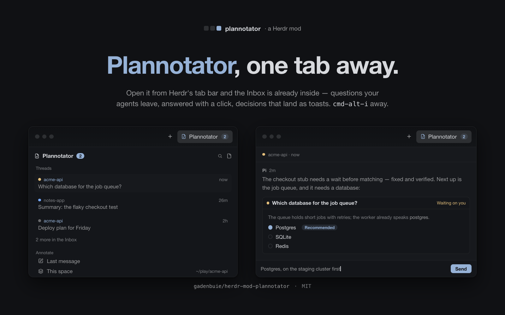

# Plannotator

A Plannotator panel in the tab bar: a Plannotator button beside Files and Changes opens a tab in the side panel that says what is in the Plannotator Inbox — the questions, summaries and reviews agents left for the person — with a dot on each thread for what it needs (yellow asks something, blue is new since the person last looked, grey is read), and starts Plannotator's own sessions (`last`, `review`, `annotate`) in the background, in the folder the person is working in. Under the threads it carries the annotate list: the last message, the review, the space's own folder ("This space", which annotates all of it), a file tree for picking one file or folder, and another folder from a picker. The palette key opens the same mod as a small command palette with its six commands, and a right-click on a tree row offers to annotate that file, its folder, or all of the space's files. Herdr cannot draw a web page, so the page itself always opens in the browser: the session runs detached, prints its address, and ends when the person decides. Being a tab in the side panel is the point of it: once the button has opened it, the copy keeps running while the panel is hidden, so a decision lands in Herdr's own toast the second it happens instead of waiting for the panel to be opened again.

## What you see

The panel is a card of its own in the side panel — 368 px wide in the person's layout, the width Files and Changes get — rounded 10, `background` fill, 1 px `border`, at 13 px in `foreground`, its content column at most 760 px wide and centred. Nothing floats: the tab bar's button and the panel column are the only chrome.

**Header**, 42 px tall, 14 px side padding, a 1 px bottom border:

- "Plannotator", 13 px semibold, then a count chip only when something waits: 10.5 px text on `accent` with `accent_foreground`, 6 px side padding, fully rounded. The chip is how many threads have an unanswered question, not how many rows are shown.
- Two 24 px icon buttons on the right: a magnifier (`search.svg`, opens the palette) and a page (`file-text.svg`, opens the Inbox). 14 px icons in `muted`, turning `foreground` on `hover`. There is no cross: the tab bar's button is what puts the panel away.

**One scroll area**, edge to edge under the header, holding both sections: the Inbox and the annotate list scroll together, and nothing is pinned to the bottom edge.

1. A 24 px section label, 11 px `dim`: "Threads". Then up to **five** threads. Each row is 6 px side margin, 12 px padding, 6 px vertical padding, rounded 7, `hover` fill on hover, and two lines. Line one starts with a 7 px round **dot** — yellow (`ansi3`) when the Inbox has the thread under "Stopped on you", "Holding up work" or "Waiting on you", blue (`ansi4`) under "New since you looked", grey (`dim`) under "Sent" or "Quiet" — then the project's name at 11 px in `dim` (in `accent` when that project's root is the folder the space is in), then the age ("now", "3m", "2h", "3d", "2w") at the right in 11 px `dim`. Line two is the subject at 13 px `muted`, one line, ellipsis. The rows come in that order — what wants the person, then what is new, then what is settled — newest first inside each group. When more than five exist, a 28 px "N more in the Inbox" row closes the list.
2. A 24 px label, 11 px `dim`, 10 px above it: "Annotate". Then rows at 30 px, 14 px padding, 9 px gap, a 14 px `muted` icon and the name at 13 px `muted`, `hover` fill on hover: `square-pen` "Last message", `git-compare` "Review changes", then **`layers` "This space"** with the space's folder in `~/…` form at 11 px `dim` on its right (one line, ellipsis). All three are the same kind of row: "This space" is a peer of the two above it, not a heading, and its click annotates the whole space folder.
3. Under "This space", indented one step: a 26 px row (6 px side margin, 20 px left padding, 8 px right, 6 px gap, rounded 6) with a 12 px `chevron-right` (or `chevron-down` when open), a 13 px `files.svg`, and "Files · 5" at 13 px `muted` when closed, plain "Files" when open. The number is how many entries the space folder has (a `…` until the read lands).
4. The tree, when that row is open: 24 px rows, 6 px side margin, 8 px right padding, 6 px gap, rounded 6, `hover` fill. Each row is indented 12 px further than its parent (up to 8 steps), then a 12 px chevron for a folder, a 13 px `folder.svg` or `file-text.svg` in `muted`, and the name at 13 px, one line, ellipsis. Folders come first, then files, each alphabetically. A folder's row carries an 18×18 pen button (`square-pen.svg`, 12 px, `dim`) at its right edge; files carry nothing, since their row is the action.
5. Last, a 30 px "Another folder…" row with `folder-plus`, styled like the rows under "Annotate".

**The row the keys are on** is filled `selected` and its label turns `foreground`; it starts on the top row — the thread that most needs the person, or "Last message" when the Inbox is empty.

An Inbox with nothing in it shows "No threads yet" (or "Reading the Inbox…" before the first read) at 13 px `muted` with "Agents leave questions and summaries in the Inbox." under it at 11.5 px `dim`; a read that fails adds its one-line error there in `blocked`.

**The palette** opens as a 520×340 popup at the pointer (it is `openOverlay` with no `at`), on `popover`, 10 px padding, 8 px gap, 12.8 px text: a 36 px search line (rounded 9, 1 px `accent` border, `background` fill, a 16 px magnifier, placeholder "Annotate, review, open the Inbox…", "Esc" at 11 px `dim` on the right) over six 34 px rows — "Annotate the last message", "Review my changes", "Annotate all files", "Annotate another folder…", "Open the Inbox", "Open Plannotator as a tab" — each with a 14 px icon, its title, and on the right either the folder (`~/…`, 11 px `dim`) or the key `keys.json` binds to it. The row under the pointer or the arrow keys is filled `selected`.

**A tree row's menu** is a popup as wide as 300 px and as tall as its items: the path in `~/…` form at 11 px `dim`, then 31 px rows, 8 px padding, rounded 7, 14 px icons, 12.8 px labels — "Annotate this file" (or "this folder"), "Annotate all files" (only when the row is not the space folder itself), "Review changes here".

**The tab bar's Plannotator button** is the only door. A pill at the right end of the tab bar, beside Files and Changes: a 14 px page-with-a-check glyph, the label at 12 px, 26 px tall, 8 px side padding, filled `selected` and `foreground` while its tab shows, `hover` fill otherwise, and a truncated label past 120 px. Clicking it shows the side panel on the Plannotator tab; clicking it again hides the panel. `cmd-alt-i` does the same from the keyboard — `tab-host.toggle:plannotator`, the same handler the click runs, which is reachable because that copy lives in the tab bar and never sleeps.

## How it behaves

- **The tab bar's button and `cmd-alt-i` both show the panel on this tab.** The button is `tab-host`'s: it selects this mod's block in the side panel's stack and shows the panel column. The key names the same handler — `tab-host.toggle:plannotator` — because a key cannot run those two commands itself, while `tab-host`'s copy in the tab bar is always alive to receive it (see the next entry). It is a toggle and says so: `toggle:` in the binding, `toggleTab()` in that mod, and `shown` or `hidden` in its log line — one press on a panel already showing this tab puts the panel away, exactly like the button.
- **The tab is on screen all the time, and that is what the toast needed.** `tab-host` keeps one block for this mod in the side panel's stack, and Herdr keeps a block's copy alive once it has started, shown or hidden. So after the button has been clicked once in a session, this mod is running for the rest of it: the sessions folder stays watched, and a decision becomes a Herdr toast within the second with the panel away. Only a copy nobody has shown yet is deferred — after a restart the first decision waits for the button (or the key) to be pressed once, which is the one hole left.
- **A pick closes the popup it came from, and the panel stays.** A palette row, a menu item and the palette's own Esc are the only things that were floating: `launch()` closes that overlay first, because the browser page is where the decision happens. From the panel itself — a thread, "N more", "Last message", "Review changes", "This space", a file's row, a folder's pen, "Another folder…", the header's page button, one of the `plannotator.*` keys — nothing is closed: the panel is a tab, and the person comes back to it.
- **The panel is one keyboard list.** ↑/↓ walk `rowIds()` — the five threads, "N more", "Last message", "Review changes", "This space", the Files toggle, every drawn tree row, "Another folder…" — and stop at the ends; Return runs the highlighted row (a folder opens or closes, everything else launches), Esc closes. The drawing and the keys read that one list, so the highlight is always the row Return runs, and a click on a folder moves the cursor there too.
- **Nothing is polled from Herdr.** Spaces, focus, theme and the folder the space is in come from `spaces()`, `focused()` and `panes()` and arrive by themselves.
- **The list is the Inbox's own, and the store is only the trigger.** `~/.plannotator/inbox/projects` is watched with `watchFolder`, so a message an agent sends shows up within a second; the rows themselves come from the Inbox server's own list model, `GET http://127.0.0.1:<port>/api/inbox/threads` (the port is in `~/.plannotator/inbox/inbox.json`), because only the Inbox keeps the read state. That route needs no token from loopback — it is the same request the Inbox page itself opens with. Without the server running there is nothing to list, and the panel says so.
- **Clicking a thread** runs `plannotator inbox --open`, which starts a stopped Inbox and opens the page in the browser, and returns at once. So does "N more in the Inbox".
- **The tree is read as it opens.** The space folder's own children are read once when the focused folder changes (that is where "Files · 5" gets its number); every folder under it is read the first time its row opens, and kept until the focused folder changes again. Collapsing keeps what was read; opening again shows it at once.
- **A folder's row in the tree opens it, a file's row annotates it.** "This space" annotates the space folder itself, the pen on any other folder's right edge annotates that folder, and a right-click opens the menu that says it in words. An annotation starts `plannotator annotate <path>`.
- **Every session runs in the background, with no tab and no window.** `start(args, label, folder)` runs one `sh` that backgrounds the CLI with `nohup` in the focused pane's folder and returns at once: `plannotator last|review|annotate … --json` opens the page in the browser by itself and waits there for the decision. The run's stdout and stderr go to `~/.config/herdr-app/data/plannotator/sessions/<stamp>-<label>.log` under a `__label` first line, and `__exit <code>` closes it. Nothing else speaks: the desktop banner the run used to post is gone, and the panel's own toast is the only notification. `--json` is what makes the end of the log say `{"decision": "approved" | "annotated" | "dismissed", …}` instead of prose; it changes nothing on the page.
- **A decision is a Herdr toast the moment it lands**, because the panel's tab is alive: the copy that starts or ticks a minute reads the sessions folder for a log with `__exit` and no `__told`, posts `notify({title: "Plannotator", body: "<label>: <decision>"})` for up to three of them, and marks each — so a decision that lands with the panel hidden is a toast within the second, and a decision that lands while it is open is the same toast (the sessions folder is watched, and the minute timer is the fallback). `__told` keeps a second copy from saying it twice.
- **Keys** arrive through `nextCommand()`: `plannotator.palette` opens the palette popup, `.last`, `.review` and `.annotate` start those sessions, `.inbox` opens the Inbox, and `focus` (a `mod.json` `"focusable": true` copy) returns the keyboard to the panel after the palette closes. A mod command reaches only a copy that is on screen, so those five keys work while the panel shows this mod's tab; the panel itself is opened by the tab bar's button or `layout.toggle:panel`, which need nothing of the mod running.
- **In the palette**, typing filters the six rows by subsequence ("rvw" finds "Review my changes"), ↑/↓ move and stop at the ends, Enter runs (the input's `submit`), Esc closes, and a pick closes before it acts. **Menus** close on Esc or a pick.
- The panel is not handed the keyboard when it appears (that would pull the keys out of the terminal that opened it): `track_focus` on the panel's root hands it over when it is clicked, and then ↑/↓/Return work on the same `rowIds()` list. Esc in the panel is left to the app, since there is no overlay to close. The palette focuses its own input, so the arrow keys reach it as soon as it opens.
- Two shown copies (the panel and a tab of the same mod) both receive a key, so the mod ignores a second command within 500 ms — one press makes one run.
- `pickFolder({prompt: "Annotate"})` is the way to a folder nobody's pane is in; it starts `plannotator annotate <folder>` in that folder.

## Built from

- `mods/plannotator/main.js` — the whole mod, one `View`.
- `mods/plannotator/mod.json` — `{ "place": "none", "title": "Plannotator", "focusable": true, "tab": { "title": "Plannotator", "icon": "mods/plannotator/icon.svg", "badge": "plannotator.waiting" } }`: `place: "none"` means Herdr never docks a copy of it, `focusable` is what lets the mod ask for its keyboard back, and `tab` is the manifest the tab bar reads (see the next entry). There is no `overlay`: the panel is not a popup, and the palette and menus open themselves with `openOverlay`.
- `mods/plannotator/icon.svg` — the button's 16 px glyph, a page with a check in it, `stroke="currentColor"` and `fill="none"` so `tab-host` tints it with the button's text color.
- **The tab is a manifest, not code, and it belongs to `tab-host`.** Herdr 0.1.12's tab bar (`tabs`) hardcodes its `files` and `changes` buttons and cannot be added to, so the person runs `herdr-mod-tab-host`: it lists every installed mod whose `mod.json` declares `tab` (or `button`), draws one button per entry in the buttons block their layout carries beside the tab bar, adds `{ "id": "tabhost-plannotator", "type": "block", "content": { "mod": "plannotator" } }` to the `panel-body` stack with `layout.set`, and resizes its own block to fit the buttons it draws (109 px for this one). Nothing is imported and no layout is edited here: the declaration is the whole dependency, and the copy it makes carries no props — which is why `props()?.mode ?? "panel"` is the only discriminator the mod needs. No props is the panel, drawn as its own card; the only overlays this mod opens are its palette and a row's menu.
- `keys.json` — six `global` bindings: `cmd-alt-i` `tab-host.toggle:plannotator` (that mod's own command: it selects this mod's block and shows the panel, or hides it when this tab is the one showing — a key cannot run those two `layout` commands itself — and its log line says which of the two it did), `cmd-alt-shift-p` palette, `cmd-alt-l` last message, `cmd-alt-r` review, `cmd-alt-a` annotate the space's folder, `cmd-alt-shift-i` open the Inbox. Merge into the person's `keys.json` rather than replacing it. **The mod's name is `tab-host`, the folder's name**, not `tabhost`: `herdr-app do tabhost.open:plannotator` is refused with `unknown command`, so a binding using it is a key that does nothing at all. The `tabhost-` prefix belongs to the block ids `tab-host` gives its contributors, not to itself.
- Props roles: no props is the panel. `{ mode: "palette" }` is the palette, `{ mode: "menu", path, dir }` is a row's menu; those two are the only copies that float (they are `openOverlay` popups and get `props().overlay`, closed with `closeOverlay(props().overlay)`), so `close()` and `launch()` are about them, and the panel has nothing to close.
- **The threads come back already sorted into the Inbox's buckets**, `sections[].threads[]`: "stopped", "holding", "waiting", "new", "sent", "quiet", each row with `thread_id`, `subject`, `last_at`, `project` and (for a row that is holding something) `questions`. `readThreads(stdout)` folds the six into the three dot states — the first three are `answer`, `new` is `unread`, the rest are `read` — sorts by that, then newest first, and takes each project's `root` from the payload's `projects` list (the only place it lives), which is how the row knows to turn `accent`. A payload with no `sections` throws, so a changed route shows up as an error line rather than as an empty Inbox.
- The tree is three pieces of state on the view: `kids` (a `Map` of folder path → its entries), `open` (a `Set` of expanded paths) and `reading` (paths whose `sh` is in flight, so one folder is never read twice at once). All three are reset when the focused folder changes, and the new root is read at once. `entries(stdout)` turns the NUL-separated pairs into `{dir, name}`, folders first, and `toggle(path, cx)` flips a path in `open` and loads it if it has no `kids` yet; `treeRows()` walks `kids` from the root through `open` into `{path, name, dir, depth}` rows, and both the drawing and the keys read it.
- The panel's rows are known by id, not by index: `rowIds()` lists them in drawing order (`t0`…`t4`, `more`, `last`, `review`, `space`, `tree`, `f:<path>`…, `pick`) and `runRow(id, cx)` runs one. `this.cursor` indexes that list and the fill is `sel(id)` — `ids[this.cursor] === id` — so no offset arithmetic can fall out of step when the Inbox or the tree changes size. `launch(fn)` closes the palette or menu it was called from before running `fn`, once: `this.closed` keeps a second `closeOverlay` off.
- Icons are the shipped ones, referenced from `~/.config/herdr-app`: `mods/workspace-chrome/{search,file-text,square-pen,git-compare,folder,folder-plus,files,layers,chevron-right,chevron-down}.svg`, drawn with `svg(...).size(n).text_color(...)`. The tab bar's glyph is this mod's own `mods/plannotator/icon.svg`.
- `herdr` functions: `spaces`, `focused`, `panes`, `exec`, `run`, `theme`, `props`, `openOverlay`, `closeOverlay`, `notify`, `watchFolder`, `pickFolder`, `home`, `appHome`, `nextCommand`, `keys`. Commands it runs: `tab.new` (only for "Open Plannotator as a tab"; sessions do not use it).
- Programs: `plannotator` on the person's `PATH` — `last`, `review`, `annotate <path>`, `inbox --open`.
- Two `sh -c` readers, each with a folder as `$1`, because a mod has no directory API:
  - the threads: `sed` pulls the port out of `inbox.json`, `curl -s -m 3` asks the Inbox for its list, and a `printf` of `{"error":"The Inbox is not running"}` covers the refused connection so the panel has something to say.
  - children: one level of one folder as `d|f` and a name, NUL-separated, at most 200 entries, `.git` skipped. Run once per folder, on demand.
- The background runner, `RUN`, is a third `sh -c` script and the one place a session is started. Its arguments after the script are `$1` the log folder, `$2` the working folder, `$3` the log's name, `$4` the label, then the CLI's argv. It `mkdir -p`s the log folder, `cd`s, and backgrounds a subshell that writes `__label <label>` as the log's first line, appends `nohup "$@" >>"$log" 2>&1`, and appends `__exit $?`. Nothing else: no notifier of either kind runs, and the decision is left in the log for `ANNOUNCE` to find. `exec` resolves in ~40 ms because the subshell is backgrounded; the CLI itself outlives Herdr thanks to `nohup`.
- The fourth `sh -c` script, `ANNOUNCE`, is the Herdr side of the same idea: it prints `<label>: <decision>` for every log that has `__exit` and no `__told`, and marks each as it goes, so the toast is posted once however many copies read at once. The mark is `__told <pid>`, appended before the print and then read back with `grep -m 1 '^__told'`: the copy whose line is the log's *first* mark prints, the others stay quiet, so two copies woken in the same instant toast once between them and neither loses the decision by arriving second. (The plain check-then-append it replaces announced five logs up to thirty times when twenty copies ran at once; this one announced exactly five in seventy-five runs.) `announce(cx)` turns those lines into `notify()` calls, three toasts at most plus a count.
- The store's own files are still worth knowing, since the Inbox's answer is derived from them: `messages.jsonl` is append-only, one JSON record per line with `seq`, `at`, `kind`, `record.thread_id`, `record.author.kind` (`agent` or `person`), `record.subject`, `record.body`, and the read cursors `person_seen_seq` / `person_read_seq` / `person_read_at` that the Inbox stamps when the person looks; `questions.jsonl` holds the questions a message asks, with `record.message_id`, `record.prompt` and `record.answer` (null until the person picks). Reading those directly is what this mod used to do, and it cannot be made right: an agent's message is re-appended under the same id whenever the thread moves, so a message's true first appearance, and therefore "is this newer than the person's cursor", is not recoverable from the tail of the file. The Inbox has the whole history in memory and the arithmetic to go with it, so ask it.

## Watch out

- **The highlight can scroll out of view.** There is no scroll-to-row for a plain `overflow_y_scrollbar` column: `VirtualListScrollHandle` is the only such API and it belongs to `v_virtual_list`, whose rows are uniform, while the panel's are 24, 26, 28, 30 and 34 px and its threads are two lines. So ↑/↓ past the fold of a long open tree moves a fill the person cannot see; the wheel still scrolls. The fix, if it matters, is to rebuild the column as a virtual list with stated item heights plus the handle, the way the shipped `picker` mod does its own scrolling.
- **There is no web view in Herdr.** The Plannotator page can only be the browser's; the background run exists to own the session and hold the address. Do not try to render the page inside a pane.
- **The app's palette can be forked, and that is the only way to add an entry.** Its source sits at `~/.config/herdr-app/frame/palette/main.js` (rewritten from the app at every start): copy it to `mods/<name>/` with its `command.svg`, add one row to its `NAMED` table (`["mod.open", { name: "plannotator" }, "App", "Show Plannotator", "panel inbox"]`), and bind a key to `mod.open:<name>` — the app's own `app.palette` command keeps opening its own palette, so a fork needs its own key. It goes stale as Herdr adds commands, which is why this mod draws its own palette instead.
- **`app.palette` cannot be extended, and it cannot even show `mod.open`.** The palette is itself a shipped mod (baked into the app, rewritten as `frame/palette` at every start). Its `entries()` is a fixed `NAMED` table, one row per layout, then every command not in `NAMED`/`HIDDEN` whose required arguments are only `name` — and `HIDDEN` contains `mod.open` (named once, in `NAMED`, as "Go to space or tab…" for the picker). So there is no "toggle a mod" entry to pick and no file to add one to; a mod's commands reach Herdr through `nextCommand()` only, which is why the palette here is the mod's own popup. Do not rebind `cmd-shift-p`.
- **A popup is as big as its content, so the mod states its size.** `overlay.height` in `mod.json` is ignored for `kind: "popup"` (a share like `0.5` makes no difference), and a flex child inside an auto-height parent collapses to nothing. The palette's rows live in a `flex_1` column, so the palette gave itself `.w(520).h(340)` in its own `render` — without it the popup was the search line and nothing else. Anything that must fill a popup states its width and height there, never in `mod.json`.
- **The tab bar's button is the door, and it is `tab-host`'s.** The button is drawn by another mod reading this one's `mod.json`; Herdr itself has no such button (`tabs`, the shipped tab bar, hardcodes `files` and `changes`), and without `tab-host` installed nothing of this mod appears on its own — `place: "none"` keeps Herdr from docking a copy. This mod's own `plannotator.*` keys reach a copy that is on screen, so with the panel hidden they are refused outright — Herdr toasts `unknown command "plannotator.inbox"` — and `cmd-alt-i` is the key to press instead: the copy it reaches belongs to `tab-host`, sits in the tab bar, and is on screen whether the panel is or not.
- **A count for the button, for when the panel is collapsed.** Every read publishes how many threads are waiting on the person to `shared("plannotator.waiting")` — written only when the number changes, because `setShared` re-renders every mod. `tab.badge` in `mod.json` names that key, and `tab-host` draws whatever is in it as a chip after the label, so the number is visible with the panel put away, which is where the panel spends its time. Neither mod knows the other's name: this one publishes a count, that one renders the number it is given, and a chip only appears when the value is above zero.
- **`layout.toggle:panel` lands on whatever tab the panel was last on, and that is why the key is not it.** `keys.json` fills a command's first argument, and showing this tab takes two commands — `layout.select {stack, child}` then `layout.show {id}` — so the plain layout toggle can only reveal the column on whatever tab the person left it on (another tab after a Files click, on a fresh session's first press). `tab-host.toggle:plannotator` is the same two commands under one name, which is the whole reason the key goes through that mod instead of through the layout.
- **`props()` gives an overlay id, and it is not the mod's name**: an `openOverlay` popup gets `{"overlay": "plannotator"}`. Close it with `closeOverlay(props().overlay)` rather than reconstructing the id.
- **An empty `div().w(12)` collapses to nothing as a row's spacer** — file rows then sit 18 px left of their folder's icon. Give a spacer a height too (`div().flex_none().w(12).h(12)`); that is what aligns a file under the chevron of a folder.
- **There is no group-hover in gpui-kit**, so a folder's pen button cannot appear only while its row is hovered: it is always drawn, `dim`, and the row's `hover` fills behind it. The pen's own click stops propagation on `on_mouse_down("left")` (`cx.stop_propagation()`) as well as on `on_click`, or the row's click would open the folder too.
- **The shipped `files` panel has no right-click handler at all**, and shipped mods are read-only, so nothing can add an entry to *its* menu: the mod's own tree is where annotating by right-click lives.
- Two copies both get the key: without the 500 ms guard one press starts two runs. The guard is module-level state, so it is per mod build, not per copy.
- **A dot is the Inbox's own bucket, not a reading of the files.** Yellow, blue and grey are "Waiting on you"/"Holding up work"/"Stopped on you", "New since you looked", and "Sent"/"Quiet" — so the dot agrees with the Inbox page, which is the thing the person will compare it against. The precedence is the Inbox's too: it marks a thread read when the person has seen it, and a read thread stays quiet even with an open question in it. Do not re-derive this from `person_seen_seq` in the store: the seen cursor is real, but a message's first appearance is not recoverable from a file tail (an agent message is re-appended under the same id on every write), which is what made an earlier version call every thread unread.
- `/api/inbox/threads` is an internal route: it is in the Inbox's own allowlist and its page opens with it, but it is not documented for mods, so a new Inbox version can change the payload. The parser throws on a payload without `sections`, which turns that into a visible error line in the panel; `curl -s http://127.0.0.1:$(sed -n 's/.*"port": *\([0-9]*\).*/\1/p' ~/.plannotator/inbox/inbox.json)/api/inbox/threads | head -c 200` is the whole check. Nothing is archived or filtered here either: the archived threads the Inbox keeps out of its list are out of this list too.
- The panel never talks to the Inbox's HTTP server (it has no public JSON routes): opening the Inbox is `plannotator inbox --open`, and everything shown comes from the files. The address in `inbox.json` is not used.
- The tree's root is the focused pane's live folder, which follows the person from pane to pane; in a space whose terminal sits in `~` it starts at the home folder, 200 entries at most per folder, with `.git` skipped and hidden names listed as they are (there is no dotfile filter).
- The panel's content column is capped at 760 px and centred; the whole panel scrolls, so opening the tree pushes the lists into that scroll. Nothing about it is remembered between sessions: a hidden column and a shown one draw the same thing.
- **A copy that is on screen keeps running, and that is what the tab bought.** Herdr starts a block's copy the first time it shows and then keeps it alive while the block is in the layout — a hidden column or another stack child included — timers and watchers and all. Proved here: with the panel hidden, a `{"decision": "approved"}` and `__exit 0` dropped into a session log became a Herdr toast a second later, with `__told` appended, no key pressed and no panel open. What it does **not** do is start a copy nobody has looked at, so after a restart the first decision waits for the button (or `cmd-alt-shift-i`) to be pressed once — and that toast needs no poll of its own: the block is in the layout, so Herdr starts it at the next start too, which is why the button is the whole mechanism. Herdr cannot post a toast from outside either (`herdr-app commands` has no toast or notify, `mod.open` takes no props, and a *settled* tab keeps its terminal but not its mod: `herdr-app do tab.new --mod plannotator`, `tab.settle`, then `plannotator.*` answers "needs the mod loaded"). A hidden column answers the same way — `unknown command "plannotator.inbox"`, the person's own report — even though its copy is still watching: a live watcher and an addressable command queue are not the same thing, which is why the inbox key is two presses when the panel is away (⌥⌘I, then ⌥⇧⌘I). Hence one signal, not three: the tab copy's Herdr toast, the second the decision lands, with the panel hidden — no desktop banner, and nothing to reconcile when a copy starts late.
- **Started runs are not tabs**, so an unexpected exit leaves nothing on screen: `plannotator review` in a folder that is not a git repo, or a `plannotator` that is not on `PATH`, shows up as `__exit 127` and `sh: plannotator: command not found` in that run's log, and the toast says the label with nothing after it. Read `~/.config/herdr-app/data/plannotator/sessions/` for it; nothing prunes those logs. `cmd-alt-*` is safe on macOS; on Linux and Windows bind `ctrl-shift-*` instead (ctrl+alt is AltGr there).
- **`tab` is not a Herdr field (0.1.12); it is `tab-host`'s manifest.** Herdr ignores an unknown key in `mod.json` — `herdr-app check` passes with it, verified — which is what makes the declaration safe to ship: it is inert without `tab-host`, and if the core takes herdrdev/herdr-app#246 the same field becomes a button Herdr draws itself. `place` must stay `"none"` either way, or Herdr docks a second copy of the panel on its own.
- The mod can still be put in a layout or a space tab (`{"type": "block", "content": {"mod": "plannotator"}}`, or "Open Plannotator as a tab" in the palette, which is a tab of the space beside the side panel's tab-host one); there it draws its own card, since no frame is drawn around it.
- The preview above is the panel as the side panel draws it, 368 px wide, cropped out of a screenshot of the whole window: the header with the two buttons, five threads with their (grey, all read) dots, and the annotate list with the tree closed. The tab bar's button is in the shot the crop came from, not in this crop.

## Done when

- `herdr-app check ~/.config/herdr-app/mods/plannotator` passes, and `~/.config/herdr-app/data/tab-host/reconcile.log` ends with a line naming `tabs=[plannotator]` and `set [files|changes|tabhost-plannotator]`.
- A Plannotator button with a page-with-a-check glyph sits at the right end of the tab bar; clicking it shows the side panel on the Plannotator tab with the button filled `selected`, clicking it again hides the panel, and `cmd-alt-i` does the same from the keyboard — including when the panel is showing **Files**: it selects this tab first, so the key never lands on whatever the panel was last on. No 380×620 popup opens any more: `herdr-app status` reports `overlays: []` after the key and after a click, and `~/.config/herdr-app/data/tab-host/reconcile.log` gets one line per press, `command "toggle:plannotator" → shown (and → hidden on the second press)`.
- With `"plannotator.waiting": 1` in `shared.json`, the button reads `Plannotator 1` — a chip after the label — with the side panel collapsed, and the panel's own header chip shows the same 1 once it is open. Narrow the window until the label truncates: the chip stays.
- Once the panel has been shown in a session, `~/.config/herdr-app/shared.json` holds `"plannotator.waiting": <n>`, where n is the number of threads in the Inbox's stopped/holding/waiting buckets (`curl -s http://127.0.0.1:<port>/api/inbox/threads | python3 -c` over `sections` answers it), and the tab bar button wears that n as a chip. It changes only when a thread changes bucket, so an unchanged list writes nothing (`setShared` re-renders every mod).
- The panel draws in the side panel's width: the header `Plannotator` with the two icon buttons and no cross, "Threads" with up to five rows, the annotate list, the Files toggle and "Another folder…" — no popup frame, no clipped rows.
- Each thread's first line starts with a 7 px dot, and the dot is the Inbox's own bucket: yellow for a thread in its "Stopped on you", "Holding up work" or "Waiting on you"; blue for one in "New since you looked"; grey for "Sent" and "Quiet". `curl -s http://127.0.0.1:<port>/api/inbox/threads` (port from `~/.plannotator/inbox/inbox.json`) shows the same sections, and a fresh Inbox where everything has been looked at is all grey. The count chip in the header is the number of yellow ones, and the rows come yellow first, then blue, then grey.
- With the Inbox server stopped, the panel says "The Inbox is not running" instead of drawing rows, and it fills itself in again (a minute at most) once `plannotator inbox --open` has started it.
- A new message an agent sends to any thread appears as a row within a second, without touching the app, and turns that thread's dot blue if the person has not looked yet.
- Clicking a thread, or the `file-text` header button, starts `plannotator inbox --open` and leaves the panel where it is; the palette button and the tree's folders also leave it up, and only the palette and a row's menu close themselves.
- With the panel focused, ↑/↓ move the `selected` fill row by row over the threads, "N more", the three annotate rows, the Files toggle, the tree rows and "Another folder…"; Return on a folder opens or closes it and on anything else starts that session; Esc does nothing (left to the app), and a click on a folder leaves the highlight on that row.
- "This space" reads as a peer of "Last message" and "Review changes", with the space's folder in `~/…` form at its right, and clicking it starts `plannotator annotate <space folder>`; "Files · N" under it counts the folder's entries and opens a tree under itself, folders first; opening a folder shows its children indented 12 px, and a folder opened two levels deep works the same. Clicking a file's row annotates that file, the pen on a folder's row annotates that folder.
- Right-clicking any tree row opens the 300 px menu; its first item annotates that path, "Annotate all files" annotates the space folder, "Review changes here" runs `plannotator review` in the row's folder.
- Clicking "Last message" starts `plannotator last` in the background (no tab appears, `ls ~/.config/herdr-app/data/plannotator/sessions/` gains a log, the annotate page opens in the browser), and the same for "Review changes" and "Another folder…"; when the page's decision is made, the log ends with `__exit 0` and **no desktop notification fires**, because `RUN` no longer calls `notify-send` or `osascript`.
- With the panel showing this tab, `cmd-alt-shift-p` opens the 520×340 palette with six rows (all of it on screen, not just the search line), the key bound to each on the right; typing `rvw`, ↑/↓, Enter and Esc all work, and Enter starts the same session the matching row would. `cmd-alt-shift-i` opens the Inbox (with the panel showing this tab; while it is collapsed Herdr toasts `unknown command "plannotator.inbox"`); `cmd-alt-a` annotates the space's folder. With the panel on another tab, hide the panel first: a mod command reaches only a copy that is on screen.
- With the panel hidden, appending `{"decision": "approved"}` and `__exit 0` to a log in `~/.config/herdr-app/data/plannotator/sessions/` posts a Herdr toast "Plannotator / <label>: approved" within a couple of seconds and appends `__told` — nothing clicked, nothing opened.
- Clicking into the side panel gives the panel the keyboard, and then ↑/↓, Return and a click on a folder work there; Esc falls through to the app instead of closing anything.
